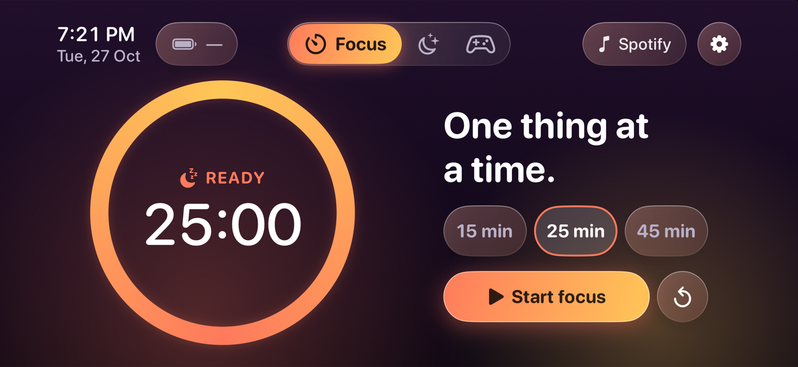
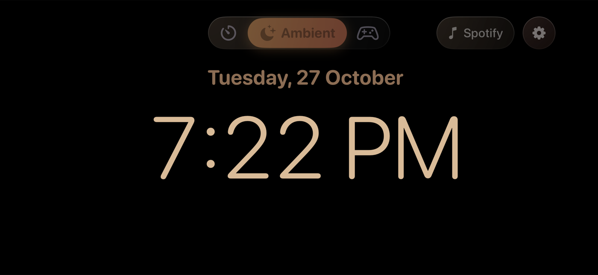
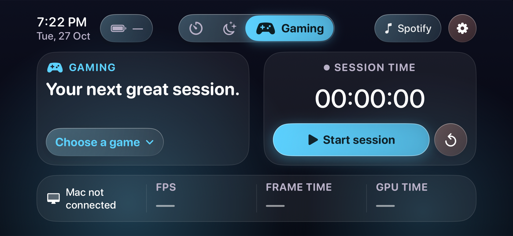

# ZeroDock

A landscape desk-stand dashboard for iPhone, built with SwiftUI (iOS 17+). It turns a charging
phone on a stand into a calm, glanceable screen with three modes. The goal is a layout that
feels at home next to Apple's StandBy while doing a few things StandBy does not.

| Focus | Ambient | Gaming |
| --- | --- | --- |
|  |  |  |

## Features

- **Focus**: a countdown ring with 15/25/45 minute presets. The timer stores a deadline, so it
  stays accurate across relaunches without a background task.
- **Ambient**: a large dim clock on black, optional seconds, and a slow drift to protect OLED screens.
- **Gaming**: pick a game manually to get its cover art, colors sampled from that cover, and a
  persistent session timer. FPS and GPU time show as unavailable until a Mac collector exists.
- **Spotify** (optional): native PKCE sign-in, read-only "now playing", original album art, no playback control.
- Battery and charging state through public APIs, and an optional keep-display-awake setting that
  only applies while the app is active. Calls and notifications follow your iOS settings.

Everything is local. There is no backend and no analytics.

## Design

The UI follows one grid so screens cannot drift apart: a centred mode switcher, two equal halves,
an 8 pt unit, flat content cards, glass only on controls, and type sized for reading from a stand.
The rules and their sources are in [docs/design-system.md](docs/design-system.md). They are
enforced by `Scripts/design-lint.sh` and by alignment tests in `UITests`.

## Build

Requirements: Xcode with an iOS 17+ SDK. Swift packages (Nuke/NukeUI 12.8.0 and FluidGradient
1.0.0) are pinned to exact versions and resolve on first build.

1. Open `ZeroDock.xcodeproj`, pick the ZeroDock scheme and an **iPhone simulator** (landscape).
2. To run on a device, set your own signing team and change the bundle identifier
   (`dev.zerodock.app`) in the target settings.

```sh
Scripts/build-simulator.sh                  # build for the iOS Simulator
Scripts/verify-simulator.sh <SIMULATOR-UDID> # unit and UI tests on an existing iPhone simulator
Scripts/test-core.sh                         # portable core tests, no Xcode project needed
Scripts/design-lint.sh                       # design-system rules
python3 Scripts/generate-project.py          # regenerate ZeroDock.xcodeproj after adding files
```

### Spotify (optional)

ZeroDock ships without a Spotify client ID. To enable the Spotify chip:

1. Create an app in the [Spotify developer dashboard](https://developer.spotify.com/dashboard).
2. Add the redirect URI `zerodock://spotify/callback`.
3. Create `Resources/Local.xcconfig` (it is git-ignored) containing:

   ```
   SPOTIFY_CLIENT_ID = your-client-id
   ```

Only the read-only `user-read-currently-playing` scope is requested, and no client secret is used.
Without a client ID the chip explains what is missing instead of failing.

## Layout of the code

- `App`: app lifecycle and the preference store.
- `Core/Models`, `Core/Services`: portable state, device, artwork and Spotify integrations.
- `Core/DesignSystem`: layout tokens (`DockLayout`), colors and type (`DockTheme`).
- `Components`: shared controls, the mode switcher and the shell.
- `Features`: one folder per mode, plus settings and music.
- `Tests`, `UITests`: portable core tests, plus simulator unit and UI tests.

## Status

Built and tested on the iPhone 18 Pro simulator only. It has not been verified on a physical
device, on other screen sizes, with extreme Dynamic Type, or through a long OLED soak. There is
no Mac companion yet, so game detection and performance metrics are not implemented.

The optional display font (Sora, SIL OFL) is not bundled. Large numerals fall back to SF Rounded.

## Licence

MIT, see [LICENSE](LICENSE). Third-party notices for Nuke and FluidGradient are in
`Resources/ThirdPartyNotices.txt`. ZeroDock is not affiliated with or endorsed by Spotify or Apple.
Game cover art is fetched at runtime from Steam's public image URLs and is not stored in this repository.
